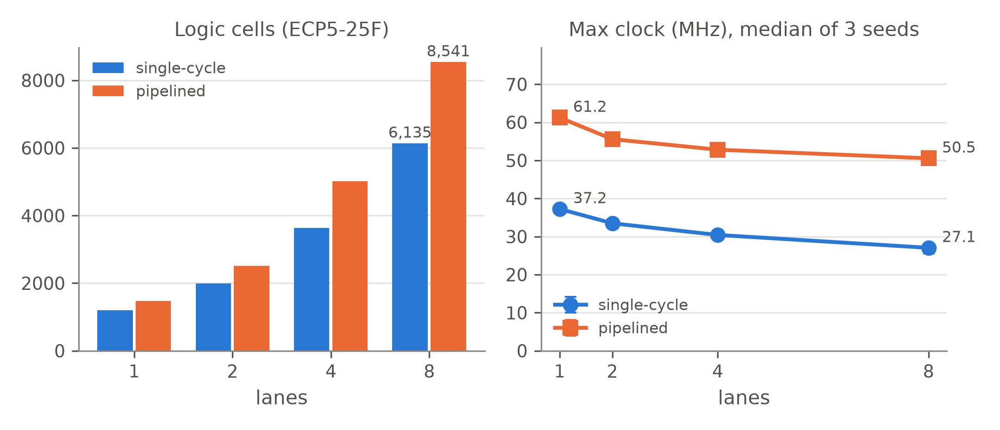
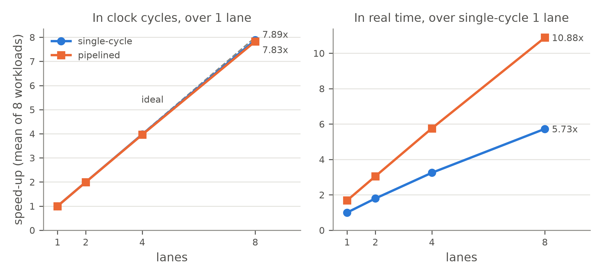

# SIMD Vector Processing Unit

[](https://github.com/mahir-m01/SIMD-Vector-Processing-Unit/actions/workflows/ci.yml)
[](rtl)
[](https://steveicarus.github.io/iverilog/)
[](https://www.veripool.org/verilator/)
[](https://github.com/YosysHQ)
[](syn)
[](LICENSE)


A parameterised SIMD vector processing unit in Verilog: eight 16-bit lanes, a 55-instruction ISA with masked (predicated) execution and saturating arithmetic, a single-cycle core and a four-stage pipelined core that run the same programs, cycle-exact verification of both against a Python golden model, and a measured comparison on FPGA.

## Overview

Image filters, audio, neural networks and physics codes repeat the same arithmetic over long arrays. A scalar processor fetches, decodes and runs one instruction per element. A **SIMD** (Single Instruction, Multiple Data) processor runs one instruction on a whole group of elements at once: one control decision drives several calculators ("lanes") working side by side.

This project builds such a unit, checks it thoroughly, and measures what it gains. Setting the lane count to 1 turns the same design into an ordinary scalar processor. The scalar baseline therefore runs the **same program** with the **same instructions** and the **same timing rules**, and any difference comes from data-level parallelism alone.

## Objectives

- Design a SIMD unit with the blocks named in the brief: vector register file, parallel ALUs, vector control unit, lane MUXes, result combiner and a scalar interface.
- Support vector ADD, SUB, AND, OR, XOR, comparisons, shifts, multiply, min and max, plus a dot-product reduction.
- Verify every lane and every instruction with self-checking testbenches and a golden model.
- Compare scalar and SIMD versions of the same workloads: cycle count, throughput and speed-up.
- Report FPGA resource use and maximum clock frequency for 1, 2, 4 and 8 lanes.
- Phase 2: pipeline the core to recover the clock speed lost to wider datapaths, add masked execution and saturating arithmetic, and measure the real-time speed-up, its dependence on problem size and the effect of unrolling.

## Architecture

<p align="center"></p>

| Block | File | Role |
| --- | --- | --- |
| Decoder | [`vec_decoder.v`](rtl/vec_decoder.v) | One decoder for both cores: fields, control signals, registers read and written |
| Vector control unit | [`vec_control_unit.v`](rtl/vec_control_unit.v) | Single-cycle core: chooses the next PC, adds the extra cycle for loads |
| Vector register file | [`vec_regfile.v`](rtl/vec_regfile.v) | 8 × 128-bit registers and the lane mask, 2 read + 1 write port, per-lane write enables, optional write-through |
| Scalar register file | [`scalar_regfile.v`](rtl/scalar_regfile.v) | 8 × 32-bit registers, `s0 = 0`, debug port for the host |
| Lane MUX | [`lane_mux.v`](rtl/lane_mux.v) | Operand B per lane: vector element or broadcast scalar |
| Parallel ALUs | [`vec_alu_lane.v`](rtl/vec_alu_lane.v), [`vec_alu_array.v`](rtl/vec_alu_array.v) | 8 copies of a 16-operation 16-bit ALU, including saturating add and subtract |
| Result combiner | [`result_combiner.v`](rtl/result_combiner.v) | Lane results as a vector, an adder-tree sum of the active lanes, and per-lane non-zero flags for `VMSK` |
| Single-cycle core | [`simd_core.v`](rtl/simd_core.v) | One instruction per cycle (the Phase 1 design, now the baseline) |
| Pipelined core | [`simd_pipe_core.v`](rtl/simd_pipe_core.v), [`hazard_unit.v`](rtl/hazard_unit.v) | Four stages (fetch, decode, execute, write), forwarding, three stall rules, backward-taken branch prediction |
| FPGA top | [`fpga_top.v`](rtl/fpga_top.v) | Either core with block-RAM memories, power-on reset and board pins |

- **Two cores, one instruction set.** The single-cycle core runs one instruction per clock (loads take two): cycles = instructions + loads. The pipelined core overlaps four instructions: cycles = instructions + 1 + stalls + wrong branch guesses. The golden model predicts both exactly.
- **Masked execution.** Any vector or reduce instruction can act on only the lanes switched on in the lane mask (`VADD.M`); `VMSK` builds the mask from a compare, so an `if` needs no branch.
- **128-bit vectors**: the width of Intel SSE and ARM NEON.

Full walkthrough: [`docs/architecture.md`](docs/architecture.md) · pipeline: [`docs/pipeline.md`](docs/pipeline.md) · instruction set: [`docs/isa.md`](docs/isa.md) · block notes: [ALUs](docs/alu.md), [register files](docs/register_files.md), [lane MUX and combiner](docs/lane_mux_and_combiner.md) · analysis: [`docs/speedup_analysis.md`](docs/speedup_analysis.md)

```asm
loop:   VLD  v1, A(s1)        # load 8 elements of A
        VLD  v2, B(s1)        # load 8 elements of B
        VADD v3, v1, v2       # 8 additions in one instruction
        VST  v3, C(s1)
        ADDI s1, s1, 1
        BNE  s1, s2, loop
```

## Results

The full write-ups are the [Phase 2 report](reports/Phase2_Report.pdf) and the [combined paper](reports/Combined_Phase1_Phase2_Paper.pdf) covering both phases; the [Phase 1 report](reports/Phase1_Report.pdf) is kept as submitted.

### Both cores on the FPGA: Lattice ECP5-25F after place-and-route

Both cores are built with `isa_test`, the program that uses every instruction, so the tools cannot remove any part of the processor. Fmax is the median of 3 placement seeds.

| Lanes | Single-cycle: cells | Fmax | Pipelined: cells | Fmax |
| --- | --- | --- | --- | --- |
| 1 | 1,197 | 37.3 MHz | 1,468 | 61.3 MHz |
| 2 | 1,996 | 33.5 MHz | 2,510 | 55.6 MHz |
| 4 | 3,639 | 30.4 MHz | 5,018 | 52.8 MHz |
| 8 | 6,135 | 27.1 MHz | 8,541 | **50.6 MHz** |

<p align="center"></p>

- **The pipeline nearly doubles the clock**: 50.6 against 27.1 MHz at 8 lanes, for 39% more logic cells. The slowest path now covers one stage instead of a whole instruction. Details: [`syn/`](syn).
- **Artix-7 (Basys-3) estimate**: 3,600 LUTs and 8 DSP48 for the pipelined 8-lane core (3,372 LUTs single-cycle).

### Speed-up

Eight workloads of N = 256 random 16-bit numbers. Every cycle count was measured on the RTL and matches the golden model exactly; real time = cycles / Fmax of that exact build.

| | 1 lane | 2 lanes | 4 lanes | 8 lanes |
| --- | --- | --- | --- | --- |
| Single-cycle, cycles, over its own 1 lane | 1.00× | 2.00× | 3.98× | 7.89× |
| Pipelined, cycles, over its own 1 lane | 1.00× | 1.99× | 3.96× | 7.83× |
| Single-cycle, real time, over single-cycle 1 lane | 1.00× | 1.79× | 3.25× | 5.73× |
| Pipelined, real time, over single-cycle 1 lane | 1.68× | 3.05× | 5.76× | **10.88×** |

<p align="center"></p>

- **Near-ideal in cycles on both cores.** The small gap to 8× is code that runs once whatever the lane count (Amdahl's law); at N = 8 the 8-lane speed-up falls to 5.0–6.1×.
- **The pipeline turns its clock into real speed**: 1.90× faster than the single-cycle core at 8 lanes (1.65–2.37× per workload), because it needs almost the same number of cycles.
- **Instruction order matters on the pipeline.** Unrolling `vadd` and `dot` four times with the loads first removes every stall: 18.6× faster than the original programs on the scalar single-cycle design. See [`docs/speedup_analysis.md`](docs/speedup_analysis.md).

### Verification

| Level | What is checked | Result |
| --- | --- | --- |
| Lane ALU | 16 operations × corner values, every shift amount, carry isolation, hand-checked saturation, 2,000 random vectors per op | 257,689 lane checks, 0 errors |
| Register files | both ports, lane write enables, mask, write-through, `s0 = 0`, debug port, random; each file built in both modes | 24,092 checks, 0 errors |
| Lane MUX + combiner | broadcast, adder tree vs plain loop, masked sums, lane flags; 1, 2, 4 and 8 lanes | about 22,000 checks per lane count, 0 errors |
| Full system | 11 workloads and 6 directed programs, both cores, 4 lane counts: every memory word, scalar and vector register, the lane mask, instruction and cycle count, plus 50 cycles after `HALT` | 136 / 136 runs match |
| Reset during a run | reset pressed at 10 different cycles of 3 programs, both cores, 4 lane counts: no write while held, then the same result as a clean run | 240 / 240 pass |
| Board version | `fpga_top` with either core, block RAM loaded with `isa_test`, started by its power-on reset alone | registers, LEDs and all 1,024 memory words match |
| Random programs | `sw/fuzz.py`: every op code, masks, random branches (short and long), addresses and data, on both cores; 25 per configuration in `make test`, 1,000 in `make fuzz` | 8,000 / 8,000 match |
| Planted bugs | 23 bugs planted in the pipeline one at a time (forwarding, stalls, write-through, branch guesses, flushes, `HALT`, reset) | all caught |

The test plan is in [`tb/README.md`](tb/README.md); how the pipeline is checked is in [`docs/pipeline.md`](docs/pipeline.md#how-it-is-checked).

### Phase 1 in one paragraph

Phase 1 built the single-cycle unit with 48 instructions and showed 7.87–7.92× fewer cycles at 8 lanes. Its clock fell from 43.3 to 29.1 MHz as lanes were added (5,396 ECP5 cells at 8 lanes), so the real speed-up was 5.3×. Phase 2 measured where that clock period goes and pipelined the core accordingly. (The single-cycle core above has the Phase 2 instruction set, which costs it some cells and clock speed; the Phase 1 numbers are in the [Phase 1 report](reports/Phase1_Report.pdf).)

## Reproducing the results

Requires [Icarus Verilog](https://steveicarus.github.io/iverilog/), [Verilator](https://www.veripool.org/verilator/) and Python 3.10+. Synthesis also needs [Yosys](https://github.com/YosysHQ/yosys) and nextpnr-ecp5 (`pip install yowasp-nextpnr-ecp5`). The figures need [uv](https://github.com/astral-sh/uv).

```bash
brew install icarus-verilog verilator yosys      # macOS; on Ubuntu: apt install iverilog verilator yosys
make test      # lint, unit tests, Python checks, both cores' full-system, reset and random runs (about 2 min)
make fuzz      # 8,000 random programs on both cores (about 6 min)
make perf      # every workload, both cores, 1, 2, 4, 8 lanes -> results/perf.csv
make sweep     # speed-up against problem size N            -> results/sweep.csv
make syn       # ECP5 place-and-route + Artix-7 estimate, both cores -> results/fpga_*.csv (about 20 min)
make plots     # results/figures/*.png
make report    # Phase 2 report and combined paper (needs tectonic)
```

To view waveforms: `python3 sw/run_workloads.py --workloads vadd --cores pipe --vcd`, then open `build/sim/vadd_L8_pipe/wave.vcd` in GTKWave or [Surfer](https://surfer-project.org).

## Repository structure

```text
SIMD-Vector-Processing-Unit/
├── rtl/                  synthesizable Verilog: both cores, decoder, hazard unit, lanes, register files, FPGA top
├── tb/                   self-checking testbenches and the verification plan
├── sw/                   assembler, golden model, workload programs, runner, plots, tests
│   └── programs/         vadd, saxpy, relu, threshold, dot, brighten, abs, sumpos, unrolled vadd and dot, isa_test
├── syn/                  FPGA synthesis sweep (ECP5, Artix-7) and the Vivado flow for Basys-3
├── results/              perf.csv, sweep.csv, fpga_ecp5.csv, fpga_artix7.csv and figures
├── docs/                 architecture, pipeline, instruction set, speed-up analysis, one page per block
├── reports/              Phase 1 and Phase 2 reports, combined paper (PDF and LaTeX source), references
├── .github/workflows/    lint and tests on every push and pull request
└── Makefile              make test | fuzz | perf | sweep | syn | plots | report
```


## Report and video

- **Phase 2 report:** [`reports/Phase2_Report.pdf`](reports/Phase2_Report.pdf) (IEEE format; LaTeX source in [`reports/src`](reports/src))
- **Combined paper, both phases:** [`reports/Combined_Phase1_Phase2_Paper.pdf`](reports/Combined_Phase1_Phase2_Paper.pdf)
- **Phase 1 report:** [`reports/Phase1_Report.pdf`](reports/Phase1_Report.pdf)
- **Prototype video (4:51):** [watch on Google Drive](https://drive.google.com/file/d/1aqpSWyA0_Q8v4WhcD_3P8AJsQFPEuM7q/view?usp=drive_link)

## Roadmap

| Phase | Focus |
| --- | --- |
| Phase 1 (done) | RTL, verification, scalar-vs-SIMD cycle comparison, ECP5 resources and Fmax |
| Phase 2 (done) | Four-stage pipelined core; masked execution and saturating arithmetic; both cores verified cycle-exactly; real-time, problem-size and unrolling analysis; final report |
| Next | Exact Vivado timing and a Basys-3 board run; power measurement; a widening multiply and vector-length control |

## References

Key works this project builds on (full list in [`reports/references.md`](reports/references.md)):

> Flynn, M. J. (1972). Some computer organizations and their effectiveness. *IEEE Transactions on Computers*, C-21(9), 948–960.

> Yiannacouras, P., Steffan, J. G., and Rose, J. (2008). VESPA: Portable, scalable, and flexible FPGA-based vector processors. *Proc. CASES*, 61–70.

> Cavalcante, M., Schuiki, F., Zaruba, F., Schaffner, M., and Benini, L. (2020). Ara: A 1-GHz+ scalable and energy-efficient RISC-V vector processor. *IEEE Transactions on VLSI Systems*, 28(2), 530–543.

## Acknowledgements

Developed as a semester project. Simulation with Icarus Verilog, lint with Verilator, synthesis and place-and-route with Yosys and nextpnr (Project Trellis for ECP5).
