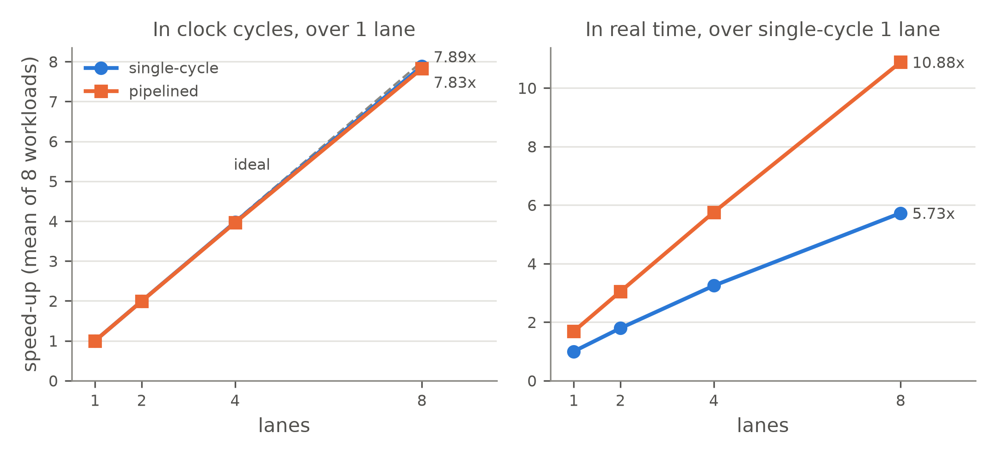
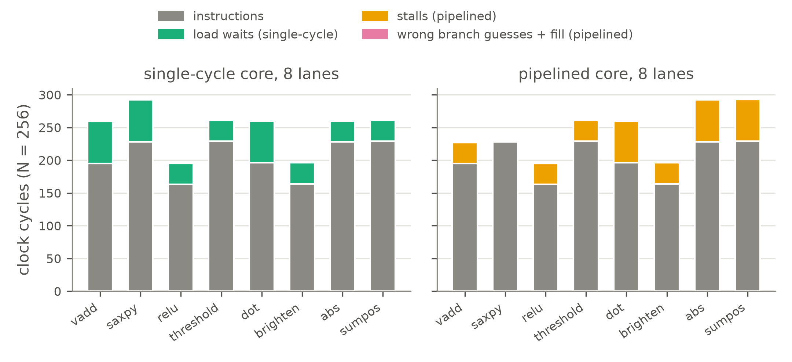
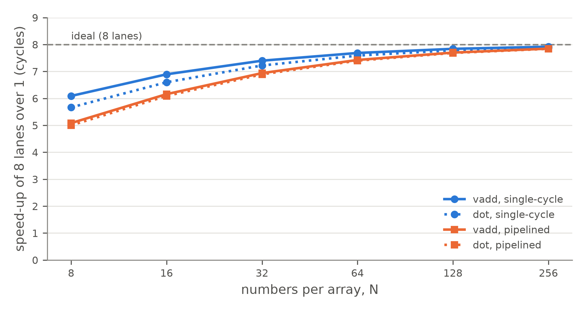
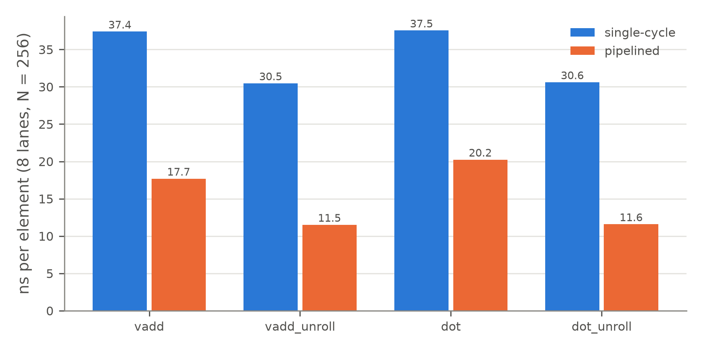

# Speed-up analysis (Phase 2)

Files: [`sw/sweep.py`](../sw/sweep.py), [`sw/plot_perf.py`](../sw/plot_perf.py), [`sw/programs/vadd_unroll.s`](../sw/programs/vadd_unroll.s), [`sw/programs/dot_unroll.s`](../sw/programs/dot_unroll.s); data in [`results/perf.csv`](../results/perf.csv), [`results/sweep.csv`](../results/sweep.csv) and [`results/fpga_ecp5.csv`](../results/fpga_ecp5.csv).

Phase 1 asked one question: how much faster are 8 lanes than 1? Phase 2 has two cores, so the questions are:

1. How much does each core gain from more lanes, counted in clock cycles?
2. How much faster is the pipelined core in **real time**, once each design's own clock speed is included?
3. Where do the clock cycles go, and what costs the pipeline its extra cycles?
4. How does the speed-up change with the problem size?
5. How much does unrolling the loops help?

Every cycle count here was measured on the Verilog core (and matches the golden model exactly). Real time is `cycles / Fmax`, with each design's median ECP5 Fmax. Averages are the plain mean over the eight benchmarks (`vadd`, `saxpy`, `relu`, `threshold`, `dot`, `brighten`, `abs`, `sumpos`, all with N = 256).

## 1 and 2. Speed-up in cycles and in real time

<p align="center"></p>

| | 1 lane | 2 lanes | 4 lanes | 8 lanes |
| --- | --- | --- | --- | --- |
| single-cycle, cycle speed-up over its own 1 lane | 1.00× | 2.00× | 3.98× | **7.89×** |
| pipelined, cycle speed-up over its own 1 lane | 1.00× | 1.99× | 3.96× | **7.83×** |
| single-cycle, real time over single-cycle 1 lane | 1.00× | 1.79× | 3.25× | **5.73×** |
| pipelined, real time over single-cycle 1 lane | 1.68× | 3.05× | 5.76× | **10.88×** |

* **Counted in cycles, both cores scale almost perfectly**: 8 lanes need 7.8–7.9× fewer cycles. The pipelined core is a little further from 8 because its few fixed extra cycles (filling the pipeline, the wrong branch guess when the loop ends) do not shrink with more lanes.
* **In real time the pipeline changes the picture.** The single-cycle core loses clock speed as lanes are added (37.3 → 27.1 MHz), so 8 lanes finish only 5.73× sooner than 1. The pipelined core keeps most of its clock (61.3 → 50.6 MHz) and starts from a faster one, so its 8-lane build is 10.88× faster than the single-cycle scalar design, and 1.90× faster than the single-cycle 8-lane build.

Per workload at 8 lanes (real time):

| Workload | Single-cycle | Pipelined | Pipelined is faster by | Why the pipeline gains less or more |
| --- | --- | --- | --- | --- |
| `vadd` | 9.57 µs | 4.53 µs | 2.11× | saves 2 load cycles per pass, stalls once |
| `saxpy` | 10.79 µs | 4.55 µs | **2.37×** | saves 2 load cycles per pass and never stalls: every loaded register is used two instructions later |
| `relu`, `threshold`, `dot`, `brighten` | 7.2–9.7 µs | 3.9–5.2 µs | 1.85× | every saved load cycle becomes a stall, so only the clock is gained |
| `abs`, `sumpos` | 9.6 µs | 5.8 µs | **1.65×** | saves 1 load cycle per pass but stalls twice (after the load, and after the masked result or the reduce sum) |

## 3. Where the cycles go

<p align="center"></p>

At 8 lanes the two cores need almost the same number of cycles (the pipelined one 0.4% fewer on average), but for different reasons:

* **Single-cycle core:** one cycle per instruction plus one extra per load, because the core waits in place for block RAM.
* **Pipelined core:** loads cost nothing extra, but an instruction that uses a loaded register, a reduce sum or a masked result **right after** it is produced waits one cycle (a stall), and the loop's last branch is guessed wrong (one cycle). Filling the pipeline adds one cycle per program. The wrong guesses and the fill together are only 2 cycles per program, too small to see in the figure.

So the pipeline's whole advantage is its clock. That is what makes the next two results matter: every stall removed is a pure gain.

## 4. Problem size

<p align="center"></p>

| N | `vadd`, single-cycle | `vadd`, pipelined | `dot`, single-cycle | `dot`, pipelined |
| --- | --- | --- | --- | --- |
| 8 | 6.09× | 5.08× | 5.67× | 5.00× |
| 16 | 6.89× | 6.16× | 6.60× | 6.09× |
| 32 | 7.40× | 6.94× | 7.22× | 6.89× |
| 64 | 7.69× | 7.43× | 7.59× | 7.40× |
| 128 | 7.84× | 7.70× | 7.79× | 7.69× |
| 256 | 7.92× | 7.85× | 7.89× | 7.84× |

This is **Amdahl's law**, measured. A program has a fixed part (the setup instructions before the loop, `HALT`, and on the pipelined core the pipeline fill and the final wrong branch guess) and a part that shrinks with more lanes (the loop). With N = 8, 8 lanes need only one pass, so the fixed part is a large share of the work and the speed-up falls to about 5–6×. By N = 256 the fixed part is lost in the loop and the speed-up is within 2% of the ideal 8×. The pipelined core falls a little further at small N because its fixed part is slightly larger.

## 5. Unrolling

<p align="center"></p>

`vadd_unroll.s` and `dot_unroll.s` do the same work as `vadd.s` and `dot.s`, but handle 4 vectors per pass and put all 8 loads first:

| 8 lanes, N = 256 | Instructions | Single-cycle cycles | Pipelined cycles | Pipelined time per element |
| --- | --- | --- | --- | --- |
| `vadd` | 195 | 259 | 229 | 17.7 ns |
| `vadd_unroll` | 147 | 211 | **149** | **11.5 ns** |
| `dot` | 196 | 260 | 262 | 20.2 ns |
| `dot_unroll` | 148 | 212 | **150** | **11.6 ns** |

Unrolling helps both cores, for two different reasons:

* **Fewer instructions.** The loop bookkeeping (`ADDI` + `BNE`) is paid once per 4 vectors instead of per vector: 4.5 instructions per vector instead of 6. Both cores gain this (single-cycle: 259 → 211 cycles).
* **No stalls.** With the loads first, every register is loaded several instructions before it is used, and in `dot_unroll` each `VDOT` writes its own register and its `ADD` comes four instructions later. The pipelined core then runs one instruction every cycle, with only the two fixed cycles on top (147 instructions, 149 cycles). The single-cycle core cannot gain this part, because its loads cost an extra cycle wherever they are.

Combined with its faster clock, the unrolled programs on the pipelined 8-lane core are **18.6×** faster than the original programs on the single-cycle 1-lane core (15.1× faster than the same unrolled programs there), and `dot` goes from 20.2 to 11.6 ns per element on the same hardware. The lesson is the usual one for pipelines: the hardware sets the clock, and the order of the instructions decides how many of those clocks are wasted.

## Reproduce

```bash
make perf        # results/perf.csv: every workload, both cores, 1/2/4/8 lanes
make sweep       # results/sweep.csv: N = 8 ... 256, both cores, 1/2/4/8 lanes
make syn         # results/fpga_ecp5.csv (about 20 minutes)
make plots       # all figures in results/figures/
```
