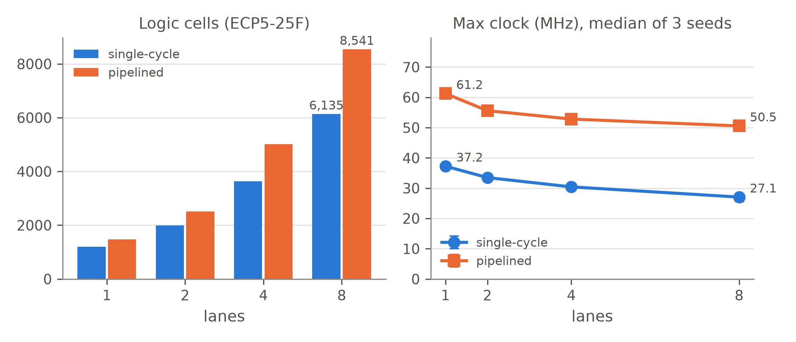

# FPGA synthesis: size and speed

Simulation proves the design is *correct*. Synthesis shows what it *costs* on a real chip (how much of the FPGA it uses) and how *fast* it can run (the maximum clock frequency, Fmax).

## Targets

| FPGA | Board examples | Tools | Gives |
| --- | --- | --- | --- |
| Lattice **ECP5-25F** (LFE5U-25F, speed 6) | ULX3S, OrangeCrab, Colorlight | Yosys + nextpnr (open source) | resources **and** Fmax after place-and-route |
| Xilinx **Artix-7 xc7a35t** | Basys-3, Arty A7 | Yosys `synth_xilinx` | resource estimate |
| Xilinx Artix-7, exact | Basys-3 | Vivado: [`vivado/build.tcl`](vivado/build.tcl) | exact resources and Fmax (needs Vivado; to run in the lab) |

Both cores are built: the single-cycle core (Phase 1 design, `simd_core.v`) and the four-stage pipelined core (Phase 2, `simd_pipe_core.v`), each for every lane count (1, 2, 4, 8), with `isa_test` already loaded in its memories. `fpga_top.v` picks the core with its `PIPELINED` parameter. `isa_test` is the program that runs every instruction. This matters: the instruction memory is read-only, so the synthesis tools look at the program in it and remove any logic it can never use. With a program that left some instructions out, the design would look smaller and faster than the real processor.

Before each build, `run_syn.py` simulates that exact board version ([`tb/tb_fpga_top.v`](../tb/tb_fpga_top.v)), started only by its power-on reset, and stops unless the selected register, the LEDs and every data-memory word match the golden model. Place-and-route picks a random starting point, so each ECP5 build is placed 3 times with different seeds and the median Fmax is reported. Fmax is nextpnr's estimate from its static timing analysis (no pin constraints), not a measurement on a board. For the median seed the script also records where the slowest path starts and ends, which shows which part of the design limits the clock.

The board version (`rtl/fpga_top.v`) adds three things to the core: 1,024 words of data memory (the same as in simulation, so every program fits), a power-on reset that holds the core for 15 clocks after the FPGA is programmed, and a two-flip-flop synchroniser on the reset button.

## Commands

```bash
pip install yowasp-nextpnr-ecp5        # or install nextpnr-ecp5 from your package manager
python3 syn/run_syn.py                 # about 20 minutes -> results/fpga_ecp5.csv, results/fpga_artix7.csv
python3 syn/run_syn.py --cores pipe    # only the pipelined core
python3 syn/run_syn.py --board-only    # just the board simulations, a few seconds (part of make test)
uv run --python 3.12 --with matplotlib python syn/plot_fpga.py     # results/figures/fpga_scaling.png

# In the lab, with Vivado installed. --board-only makes the memory files and needs only iverilog:
python3 syn/run_syn.py --board-only --lanes 8
vivado -mode batch -source syn/vivado/build.tcl -tclargs 8           # pipelined core
vivado -mode batch -source syn/vivado/build.tcl -tclargs 8 single    # single-cycle core
```

## Results

<p align="center"></p>

**Lattice ECP5-25F, after place-and-route** (`results/fpga_ecp5.csv`)

| Core | Lanes | Logic cells (of 24,288) | Flip-flops | Multipliers (of 28) | Block RAM (of 56) | Fmax, median of 3 seeds | Slowest path |
| --- | --- | --- | --- | --- | --- | --- | --- |
| single-cycle | 1 | 1,197 (4.9%) | 17 | 1 | 2 | 37.3 MHz | instruction RAM → vector registers |
| single-cycle | 2 | 1,996 (8.2%) | 18 | 2 | 3 | 33.5 MHz | instruction RAM → scalar registers |
| single-cycle | 4 | 3,639 (15.0%) | 20 | 4 | 5 | 30.4 MHz | instruction RAM → scalar registers |
| single-cycle | 8 | 6,135 (25.3%) | 24 | 8 | 9 | 27.1 MHz | instruction RAM → scalar registers |
| pipelined | 1 | 1,468 (6.0%) | 189 | 1 | 2 | 61.3 MHz | instruction RAM → instruction RAM |
| pipelined | 2 | 2,510 (10.3%) | 207 | 2 | 3 | 55.6 MHz | X stage register → W stage register |
| pipelined | 4 | 5,018 (20.7%) | 243 | 4 | 5 | 52.8 MHz | X stage register → W stage register |
| pipelined | 8 | 8,541 (35.2%) | 315 | 8 | 9 | 50.6 MHz | W stage register → W stage register |

**Xilinx Artix-7 xc7a35t, Yosys estimate** (`results/fpga_artix7.csv`). The design is flattened first, as the ECP5 flow does, so every cell is counted once.

| Core | Lanes | LUTs (of 20,800) | LUTs used as RAM | Flip-flops | DSP48 (of 90) | Block RAM 36K (of 50) |
| --- | --- | --- | --- | --- | --- | --- |
| single-cycle | 1 | 640 | 22 | 43 | 1 | 0.5 |
| single-cycle | 2 | 1,021 | 28 | 44 | 2 | 1 |
| single-cycle | 4 | 1,811 | 40 | 47 | 4 | 2 |
| single-cycle | 8 | 3,372 | 64 | 51 | 8 | 4 |
| pipelined | 1 | 779 | 22 | 209 | 1 | 0.5 |
| pipelined | 2 | 1,214 | 28 | 227 | 2 | 1 |
| pipelined | 4 | 2,018 | 40 | 265 | 4 | 2 |
| pipelined | 8 | 3,600 | 64 | 337 | 8 | 4 |

## What the numbers say

* **The pipeline nearly doubles the clock.** At 8 lanes the pipelined core runs at 50.6 MHz against 27.1 MHz (1.87×); at 1 lane, 61.3 against 37.3 MHz (1.64×). The single-cycle core's slowest path still runs through a whole instruction in one cycle: instruction out of block RAM, register read, lane ALU (usually the multiplier), adder tree, scalar register. In the pipelined core each path covers one stage only.
* **Where the pipelined core is now limited.** At 1 lane the slowest path is the fetch loop: the instruction leaves block RAM, is decoded, and the branch guess picks the next fetch address, all in one cycle ("instruction RAM → instruction RAM"). From 2 lanes on it is stage X: an operand forwarded from W, through the lane multiplier, into the X/W register. That path grows with the lanes because the forwarding switches and the wiring grow with the vector width.
* **The clock drops more slowly with lanes in the pipeline.** From 1 to 8 lanes the single-cycle core loses 27% of its clock, the pipelined core 17%, because the adder tree (which deepens with more lanes) now has a stage of its own.
* **The price is area.** The pipelined core needs 39% more ECP5 logic cells at 8 lanes (8,541 against 6,135) and about 300 more flip-flops for the pipeline registers; on Artix-7, whose 6-input LUTs absorb the extra multiplexers better, only 7% more LUTs. The forwarding and write-through multiplexers are 128 bits wide each, which is most of the difference. The design still uses only 35% of the ECP5-25F.
* **Phase 2 features cost the single-cycle core some speed too.** Masked execution (per-lane write enables and the mask register), `VMSK` and the saturating jobs make the single-cycle 8-lane build 6,135 cells at 27.1 MHz, against 5,396 cells at 29.1 MHz for the Phase 1 build (the Phase 1 numbers are in `results/fpga_ecp5.csv` at commit `1568f01`). The comparison between the two cores above is fair: both have exactly the same instruction set.
* **Area still grows less than the lanes.** 8 lanes cost 5.1× the logic of 1 lane on the single-cycle core and 5.8× on the pipelined core, not 8×, because the control logic, the scalar registers and the memories are shared.

## Files

| File | Purpose |
| --- | --- |
| [`run_syn.py`](run_syn.py) | Runs the sweep and writes the two CSV files. |
| [`plot_fpga.py`](plot_fpga.py) | Draws the scaling figure. |
| [`vivado/build.tcl`](vivado/build.tcl), [`vivado/basys3.xdc`](vivado/basys3.xdc) | Vivado flow and pin map for the Basys-3 board, for either core. Not yet run (Vivado does not run on macOS, the development machine). The Basys-3 clock is 100 MHz, above the expected Fmax of both cores, so a slower clock (clock divider or MMCM) is needed before running on the board. |
