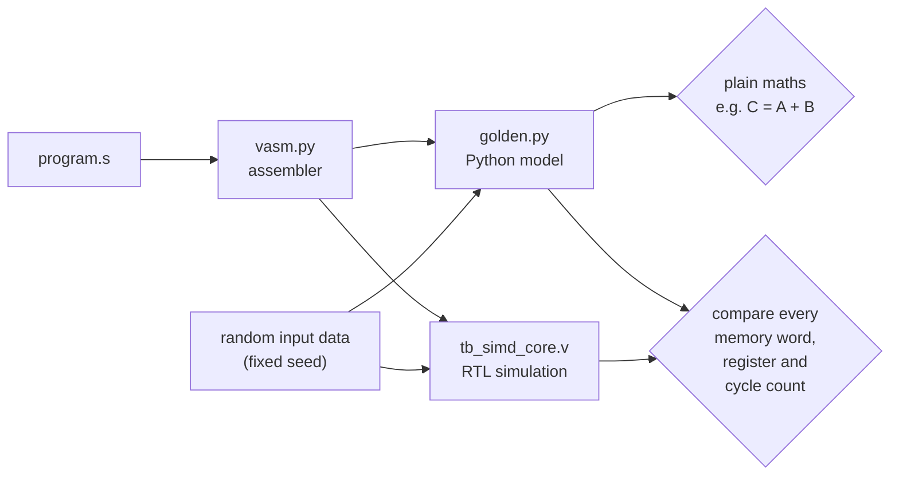

# Verification

Every block is tested on its own first (unit tests), then the whole processor runs real programs (system tests), on **both cores**: the single-cycle core and the pipelined core run the same programs and must both match the golden model, including its cycle count for each core. Every test checks itself and prints `TEST PASSED` or `TEST FAILED`. Run them all with:

```bash
make test
```

## Test plan

| Level | Testbench | What it checks | Size |
| --- | --- | --- | --- |
| Unit | [`tb_vec_alu.v`](tb_vec_alu.v) | All 16 ALU jobs on 8 lanes against a separate integer model. All 64 pairs of 8 tricky values (0, 1, −1, 32767, −32768, …), every shift amount 0–23, no carry leaking between lanes, 2,000 random vectors per job, nine saturation cases with hand-written answers, and each saturating job seen both clamping and not. | 257,689 lane checks |
| Unit | [`tb_regfiles.v`](tb_regfiles.v) | Vector and scalar register files, each built twice (normal and write-through) on the same inputs: every register through both read ports, write-enable off, lane write enables, the lane mask, read-during-write in both modes, `s0` stays 0, debug port, 2,000 random cycles each. | 24,092 checks |
| Unit | [`tb_lane_combiner.v`](tb_lane_combiner.v) | Lane MUX in both modes; result combiner sum against a plain loop, with the extreme values; masked sums (every lane off, each lane alone, random enables) and the non-zero lane flags. Run for 1, 2, 4 and 8 lanes. | about 22,000 checks × 4 |
| System | [`tb_simd_core.v`](tb_simd_core.v) | Whole programs on either core (`PIPELINED` = 0 or 1). After `HALT` it keeps the clock running for 50 more cycles (no memory write is allowed), then compares all 1,024 data-memory words, all 8 scalar registers, all 8 vector registers, the lane mask, the instruction count and the cycle count with the Python golden model. Inputs are random over the full 16-bit range. | 11 programs × 4 lane counts × 2 cores |
| System | [`../sw/directed_tests.py`](../sw/directed_tests.py) | Corner cases on the same testbench: `corners` (writes to `s0`, wrap-around, wide broadcast, saturating jobs, unused op codes), `pc_wrap`, `branch_halt` (`BNE` on bits 16 and 31, unused fields, nothing after `HALT`), `hazards` (every pipeline hazard, branch guesses right and wrong, a wrong-path `HALT` and store), `masks` and `far_branch` (offsets beyond ±127). | 6 programs × 4 lane counts × 2 cores |
| System | `+reset_at` in [`tb_simd_core.v`](tb_simd_core.v) | Reset pressed in the middle of `vadd`, `dot` and `abs`, at 10 different cycles: nothing may be written while it is held, and the restarted program must end exactly as a clean run. | 240 runs |
| Board | [`tb_fpga_top.v`](tb_fpga_top.v) | The FPGA version of either core with its block RAM, loaded with `isa_test` (every instruction) and started only by its power-on reset (no button press): `s7` on the LEDs and all 1,024 data-memory words must match the golden model. | 4 lane counts × 2 cores |
| System | [`../sw/fuzz.py`](../sw/fuzz.py) | Random programs on both cores: every op code, the mask bit, `VMSK`, random fields, short and long branches, addresses and memory contents. | 25 per configuration in `make test`; 1,000 in `make fuzz` |
| Software | [`../sw/tests/`](../sw/tests) | Assembler encodings worked out by hand (including the new instructions), branch offsets, label and constant checks, error messages, every program assembles; golden-model corner cases, saturation, masks and the pipelined cycle count. | 16 tests |

## How the system test decides "correct"



There are two separate checks:

1. **Golden model vs plain maths.** This catches mistakes in the *program*. For example, the vector-add result must equal `[a + b for a, b in zip(A, B)]`.
2. **Hardware vs golden model.** This catches mistakes in the *hardware*. Memory, registers and timing must match exactly.

## Coverage

* **Instructions.** [`isa_test.s`](../sw/programs/isa_test.s) runs every vector–vector, vector–scalar and reduce instruction on random 16-bit data, masked vector, vector-scalar and reduce instructions, `VMSK`, plus `VDOT`, loads, stores, `ADDI`, `ADD`, `BNE` and `HALT`. Together with the benchmark programs, all 55 instructions run on both cores.
* **ALU outcomes.** `tb_vec_alu` prints how many times each job was checked. It also fails if a compare job never produced both a true and a false answer.
* **Corner cases.** The directed programs cover what the benchmarks never do: wrap-around, back-to-back loads, branches into loads, unused op codes. They came out of an independent review of the design; the hardware and the golden model agreed on every one.
* **Lane counts.** Every system program runs with 1, 2, 4 and 8 lanes in `make test`, so lanes that exist in one build but not another are tested too.
* **The board version.** `make board` runs the FPGA top exactly as built, memories included, and checks the LEDs and every memory word.
* **Random programs.** [`sw/fuzz.py`](../sw/fuzz.py) makes up programs nobody wrote by hand: every op code, random fields (including the mask bit 16), `VMSK`, short and long branches, addresses and memory, on both cores. `make test` runs 25 per lane count and core and `make fuzz` 1,000; the RTL and the golden model have agreed on every one (8,000 in the Phase 2 run).
* **Pipeline hazards.** The `hazards` program puts every kind of result right before every kind of instruction that needs it; the cycle count catches a missing or an extra stall, because the golden model predicts the exact count. See [`docs/pipeline.md`](../docs/pipeline.md#how-it-is-checked).

## Do the tests actually catch bugs?

The tests were checked by breaking the design on purpose ("mutation testing"):

| Bug introduced | Caught by | Result |
| --- | --- | --- |
| `SRA` made a logical shift (sign not kept) | `tb_vec_alu` | mismatches on every negative input |
| Adder tree pairs the wrong lanes | `tb_lane_combiner` | 5,002 errors |
| Control unit forgets to wait for load data | `tb_simd_core` | every result word wrong |
| Combiner zero-extends instead of sign-extending (1 lane) | `tb_lane_combiner` | 2,507 errors |
| Core keeps running the instructions after `HALT` | `tb_simd_core` (`branch_halt`) | memory and register mismatches |
| `BNE` compares only the low 16 bits (or ignores bit 31) | `tb_simd_core` (`branch_halt`) | memory mismatches |
| `VST`, `BNE` or `HALT` also writes a vector register | `tb_simd_core` (vector registers) | vector register mismatches |
| FPGA top stores to the wrong address | `tb_fpga_top` (memory check) | every stored word wrong |

Phase 2 added 23 bugs planted in the pipelined core one at a time (each forwarding path switched off, each stall rule removed, write-through off, branch guesses always "not taken" or made from the wrong offset bit, no flush after a wrong guess, a store in a bubble or during reset, a register write during reset, `HALT` one stage late, and more). Every one makes `run_workloads.py` or `fuzz.py` fail; the list is in [`docs/pipeline.md`](../docs/pipeline.md#how-it-is-checked).

## Waveforms

To look at signals in GTKWave or [Surfer](https://surfer-project.org):

```bash
python3 sw/run_workloads.py --workloads vadd --lanes 8 --cores pipe --vcd
gtkwave build/sim/vadd_L8_pipe/wave.vcd
```
